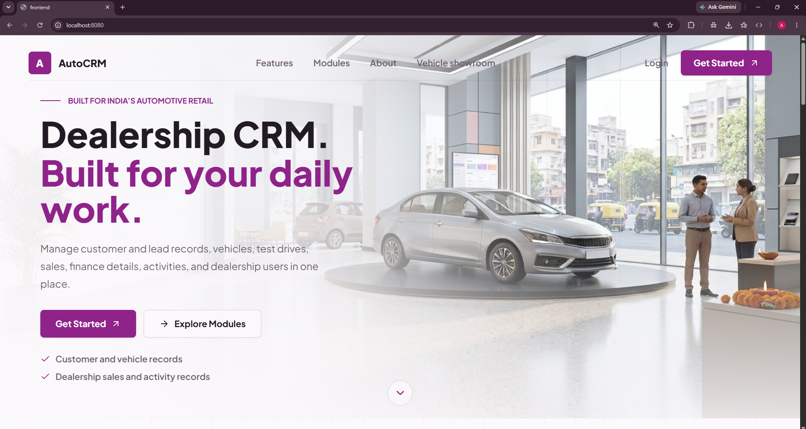

# AutoCRM

**A multi-tenant CRM for automobile dealerships, built to manage the full customer-to-sale journey in one place.**

`Customer → Lead → Vehicle → Test Drive → Sale → Finance/EMI`

---

## What is AutoCRM?

AutoCRM is a web-based Dealership CRM built for India's automotive retail, especially small and mid-size used-vehicle showrooms. Each dealership gets its own isolated workspace (a *tenant*) on one shared platform, with role-based access for admins and sales staff, and a public showroom website for buyers.

## What does it do?

- **Customers & Leads:** record enquiries, track source, interested vehicle and lead stage (New / Contacted / Qualified / Converted / Lost), assign owners, and reach out via WhatsApp
- **Activities & Follow-ups:** schedule follow-ups and see overdue ones on the dashboard
- **Inventory:** manage vehicles, photos, inspections, availability and public showroom visibility
- **Test Drives:** schedule and track test drives against a lead and vehicle
- **Sales & Finance:** record sales with payment status (Pending / Partial / Paid) and sale status (Confirmed / Cancelled), plus finance/EMI details
- **Users & Roles:** dealership admins create and manage `ADMIN` and `SALES` users
- **Audit History:** filterable log of who changed what and when
- **Website Builder:** each dealership gets a branded public site (hero, about, featured inventory, EMI calculator, footer) with custom colours, typography and logo
- **Public Showroom & Enquiry:** buyers browse published vehicles and send enquiries straight into the CRM
- **Platform Control Panel:** `PLATFORM_ADMIN` onboards new dealerships

## The real-life problem it solves

Small dealerships usually run on notebooks, spreadsheets, phone contacts and WhatsApp chats. That causes:

| Problem | How AutoCRM solves it |
|---|---|
| Customer, vehicle, test-drive and sale info is scattered | One connected workflow with linked records |
| Follow-ups depend on staff memory | Follow-ups and overdue alerts on the dashboard |
| No record of which vehicle a customer tested or bought | Test drives and sales tied to customer + vehicle |
| No traceability of who changed what | Audit History with actor, action, date and record |
| Anyone can edit anything | JWT login + role-based access (`PLATFORM_ADMIN`, `ADMIN`, `SALES`) |
| Many dealerships on one platform could leak data | Backend-enforced tenant isolation |
| Heavy, expensive CRMs don't fit small showrooms | Lightweight modular monolith, low running cost |
| Buyers can't see stock online | Public showroom + enquiry form feeding the CRM |

---

## Screenshots

### 1. Landing page



### 2. Sign up


### 3. Login


### 4. Dashboard


### 5. Leads


### 6. Inventory


### 7. Sales


### 8. Users & Roles


### 9. Audit History


### 10. Website Builder


### 11. Public Dealership Website


---

## Tech Stack

**Backend**
- Java, Spring Boot 4.1
- Spring Security with JWT authentication
- Role-based access control (`PLATFORM_ADMIN`, `ADMIN`, `SALES`)
- Spring Data JPA / Hibernate
- Jakarta Bean Validation (custom validators)
- Maven

**Frontend**
- React + TypeScript
- Vite

**Database**
- PostgreSQL (shared database, tenant-scoped rows)

**Architecture**
- Modular monolith, REST (JSON) APIs
- Pooled multi-tenancy: tenant resolved from the authenticated user, never from the request body

---

## Project Structure

```
AutoCRM/
├── src/
│   ├── main/
│   │   ├── java/com/autocrm/
│   │   │   ├── AutoCrmApplication.java
│   │   │   ├── validation/          # Custom validators (test drive status, payment status, fuel type)
│   │   │   └── ...                  # controllers, services, repositories, entities, security
│   │   └── resources/               # application config
│   └── test/                        # Backend tests
├── Frontend/
│   ├── src/
│   │   ├── assets/
│   │   └── components/              # AppLayout, AuthLayout, PageHeader, RequireAuth, ui/ ...
│   └── dist/                        # Production build
├── docs/
│   └── screenshots/                 # README images
├── pom.xml
├── mvnw / mvnw.cmd
└── .env                             # Local config (not committed)
```

> Request flow: Spring Security filter (JWT + tenant + role) → Controller (DTO validation) → Service (business rules) → Repository (tenant-scoped) → PostgreSQL.

---

## Getting Started

**Prerequisites:** JDK, Node.js, PostgreSQL

```bash
# 1. Clone
git clone https://github.com/Aditya-deshmukh-1410/AutoCRM.git
cd AutoCRM

# 2. Configure environment
# create a .env with your database URL, username, password and JWT secret

# 3. Build the frontend
cd Frontend
npm install
npm run build
cd ..

# 4. Run the backend
./mvnw clean package
java -jar target/autoCRM-0.0.1-SNAPSHOT.jar
```

App runs at **http://localhost:8080**

## Roles

| Role | Responsibility |
|---|---|
| `PLATFORM_ADMIN` | Onboards and manages dealerships (tenants) via the Control Panel |
| `ADMIN` | Manages one dealership: users, inventory, settings, showroom publishing |
| `SALES` | Day-to-day work on customers, leads, activities, test drives and sales |

## Contributing

Contributions are welcome. Fork the repo, create a feature branch, and open a pull request.

## License

Add a license of your choice (e.g. MIT).
