<div align="center">


# AutoCRM

### *Your All-in-One Dealership CRM Platform*

> A full-stack multi-tenant CRM for automobile dealerships, combining lead tracking, inventory, test drives, sales records and a public showroom website, built for India's automotive retail and real-world use.

<br/>


<br/>


</div>

---

<p align="center">
  <b>Customer</b> → <b>Lead</b> → <b>Vehicle</b> → <b>Test Drive</b> → <b>Sale</b> → <b>Finance/EMI</b>
</p>

---

## What does it do?

## What does it do?

| Module | What it does |
|---|---|
| **Customers & Leads** | Record enquiries, track source and interested vehicle, move leads through stages, assign owners, message on WhatsApp |
| **Activities & Follow-ups** | Schedule follow-ups, see overdue ones on the dashboard |
| **Inventory** | Manage vehicles, photos, inspections and availability, choose what shows on the public site |
| **Test Drives** | Schedule and track test drives for a lead and vehicle |
| **Sales & Finance** | Record sales with payment and sale status, plus finance/EMI details |
| **Users & Roles** | Admins create and manage `ADMIN` and `SALES` users |
| **Audit History** | Filterable log of who changed what and when |
| **Website Builder** | Branded public site with custom colours, fonts, logo and an EMI calculator |
| **Public Showroom** | Buyers browse published vehicles and send enquiries into the CRM |
| **Control Panel** | `PLATFORM_ADMIN` onboards new dealerships |

**Lead stages:** `New` → `Contacted` → `Qualified` → `Converted` / `Lost`

**Sale payment status:** `Pending` · `Partial` · `Paid`

## The real-life problem it solves

Small dealerships usually run on notebooks, spreadsheets, phone contacts and WhatsApp chats. That causes:

| Problem | How AutoCRM solves it |
|---|---|
| Customer, vehicle, test-drive and sale info is scattered | One connected workflow with linked records |
| Follow-ups depend on staff memory | Follow-ups and overdue alerts on the dashboard |
| No record of which vehicle a customer tested or bought | Test drives and sales tied to customer + vehicle |
| No traceability of who changed what | Audit History with actor, action, date and record |
| Anyone can edit anything | JWT login + role-based access (`PLATFORM_ADMIN`, `ADMIN`, `SALES`) |
| Many dealerships on one platform could leak data | Backend-enforced tenant isolation |
| Heavy, expensive CRMs don't fit small showrooms | Lightweight modular monolith, low running cost |
| Buyers can't see stock online | Public showroom + enquiry form feeding the CRM |

---

## Screenshots

### 1. Landing page

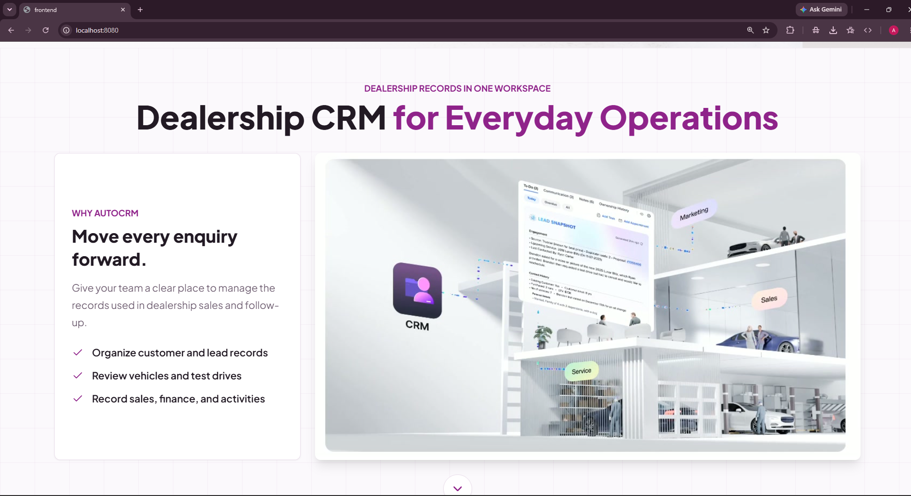
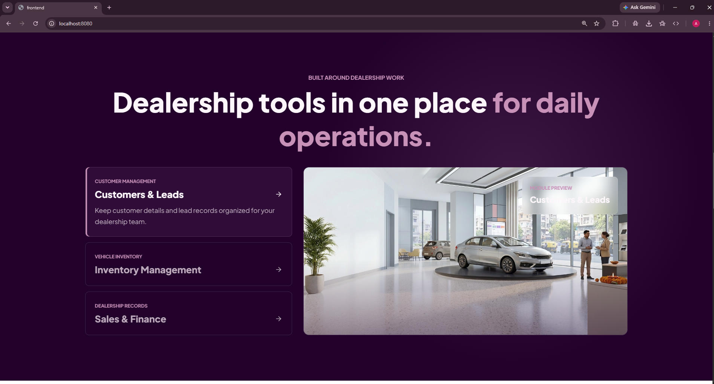
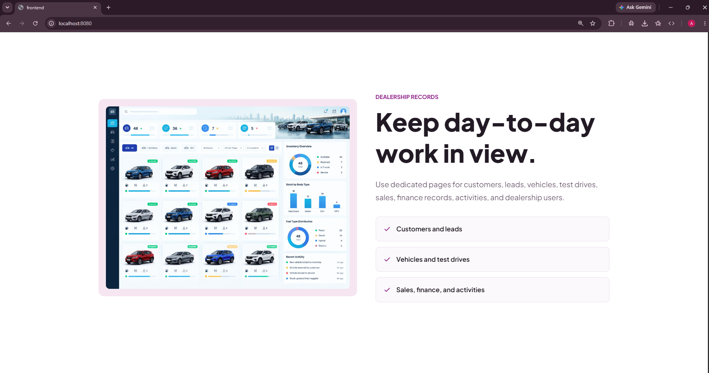

### 2. Sign up
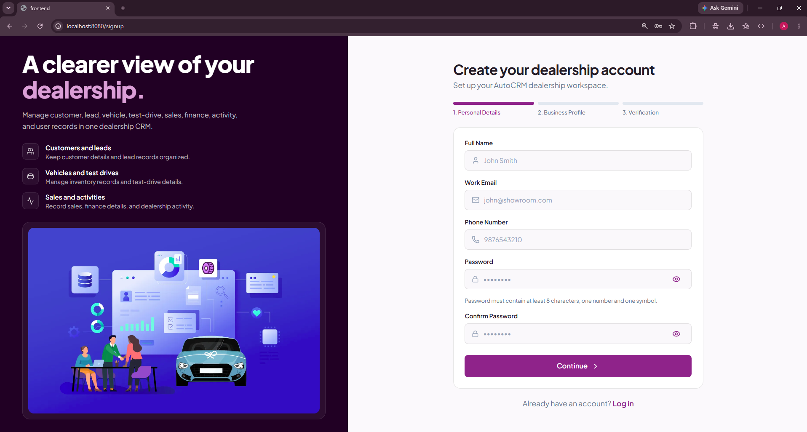

### 3. Login
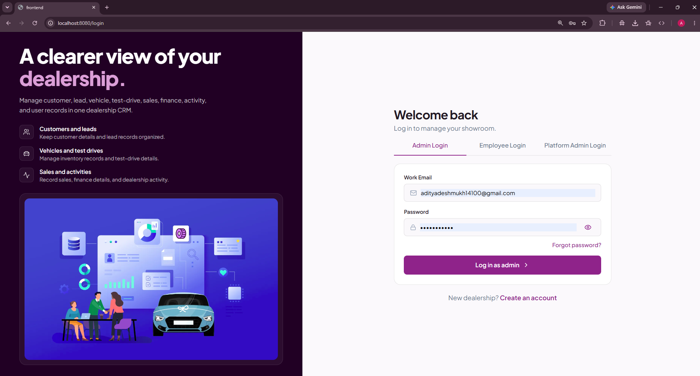

### 4. Dashboard
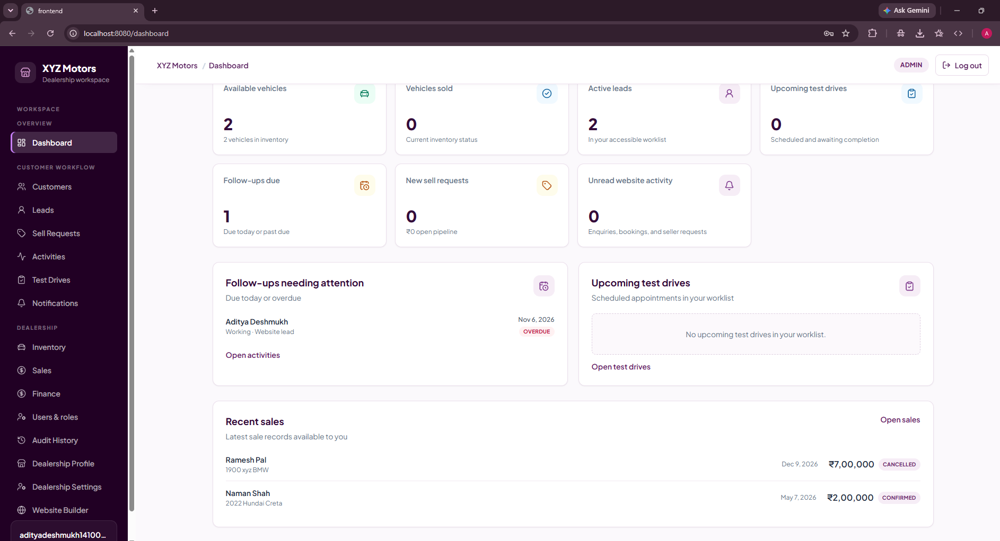

### 5. Leads
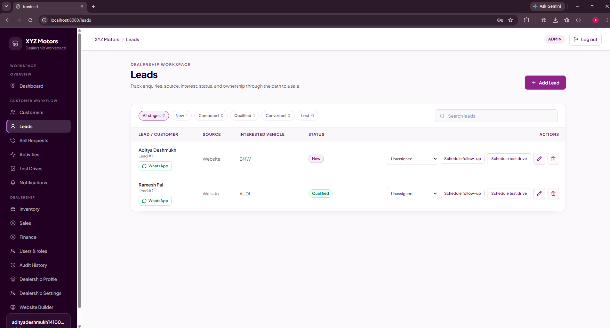

### 6. Inventory
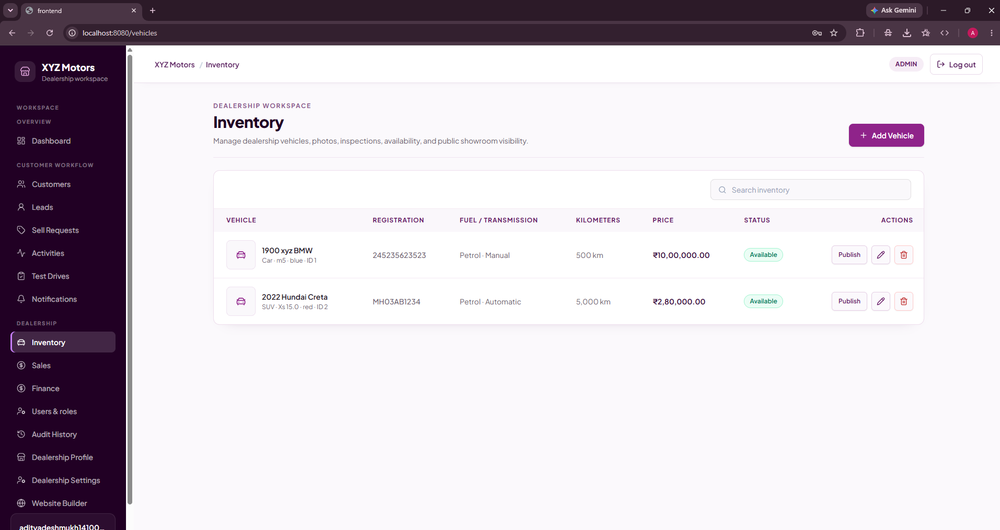

### 7. Sales
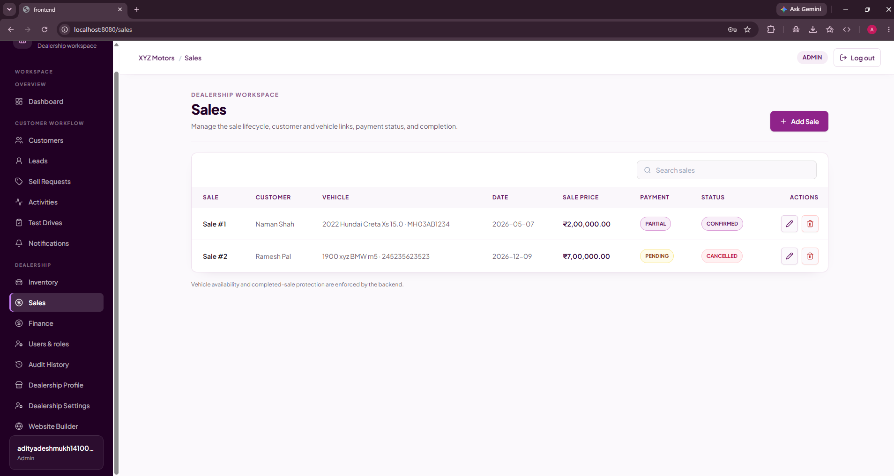

### 8. Users & Roles


### 9. Audit History
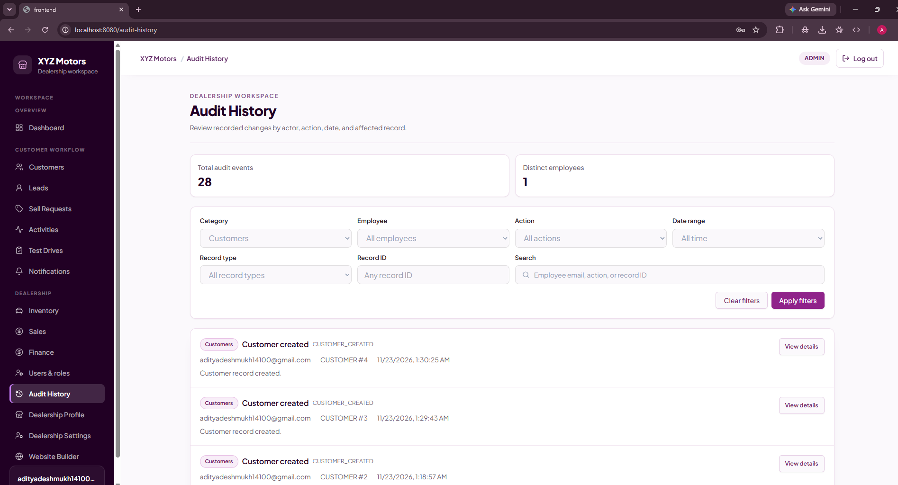

### 10. Website Builder
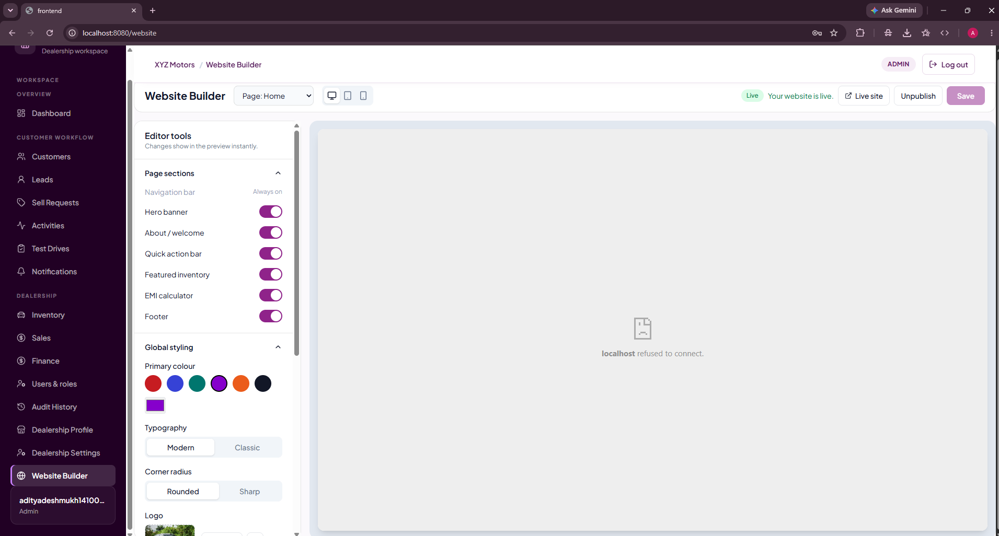

### 11. Public Dealership Website
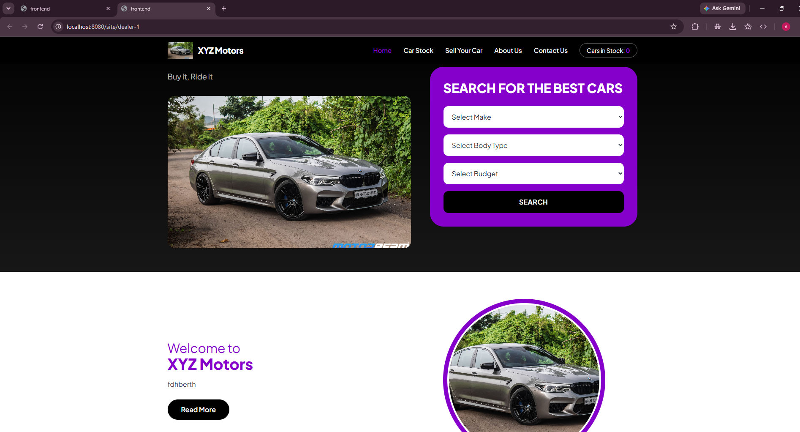

---

## Tech Stack

**Backend**
- Java, Spring Boot 4.1
- Spring Security with JWT authentication
- Role-based access control (`PLATFORM_ADMIN`, `ADMIN`, `SALES`)
- Spring Data JPA / Hibernate
- Jakarta Bean Validation (custom validators)
- Maven

**Frontend**
- React + TypeScript
- Vite

**Database**
- PostgreSQL (shared database, tenant-scoped rows)

**Architecture**
- Modular monolith, REST (JSON) APIs
- Pooled multi-tenancy: tenant resolved from the authenticated user, never from the request body

---

## Project Structure

```
AutoCRM/
├── src/
│   ├── main/
│   │   ├── java/com/autocrm/
│   │   │   ├── AutoCrmApplication.java
│   │   │   ├── validation/          # Custom validators (test drive status, payment status, fuel type)
│   │   │   └── ...                  # controllers, services, repositories, entities, security
│   │   └── resources/               # application config
│   └── test/                        # Backend tests
├── Frontend/
│   ├── src/
│   │   ├── assets/
│   │   └── components/              # AppLayout, AuthLayout, PageHeader, RequireAuth, ui/ ...
│   └── dist/                        # Production build
├── docs/
│   └── screenshots/                 # README images
├── pom.xml
├── mvnw / mvnw.cmd
└── .env                             # Local config (not committed)
```

> Request flow: Spring Security filter (JWT + tenant + role) → Controller (DTO validation) → Service (business rules) → Repository (tenant-scoped) → PostgreSQL.

### Project in IDE
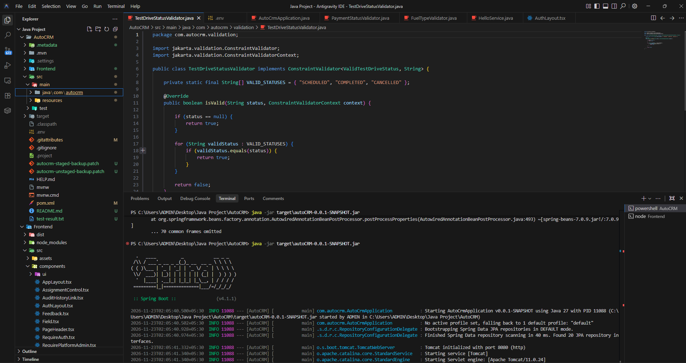

---

## Getting Started

**Prerequisites:** JDK, Node.js, PostgreSQL

```bash
# 1. Clone
git clone https://github.com/Aditya-deshmukh-1410/AutoCRM.git
cd AutoCRM

# 2. Configure environment
# create a .env with your database URL, username, password and JWT secret

# 3. Build the frontend
cd Frontend
npm install
npm run build
cd ..

# 4. Run the backend
./mvnw clean package
java -jar target/autoCRM-0.0.1-SNAPSHOT.jar
```

App runs at **http://localhost:8080**

## Roles

| Role | Responsibility |
|---|---|
| `PLATFORM_ADMIN` | Onboards and manages dealerships (tenants) via the Control Panel |
| `ADMIN` | Manages one dealership: users, inventory, settings, showroom publishing |
| `SALES` | Day-to-day work on customers, leads, activities, test drives and sales |

## Contributing

Contributions are welcome. Fork the repo, create a feature branch, and open a pull request.

## License

Add a license of your choice (e.g. MIT).
